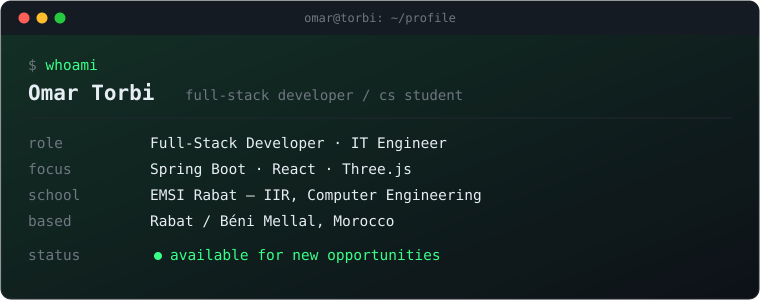

<div align="center">
  <!-- Interactive Terminal Card -->
  
  
  <br/><br/>

  <!-- Dynamic Typing Header -->
  <a href="https://github.com/TORBIomar">
    
  </a>
  <br/><br/>
  <!-- Social & Profile Badges -->
  <a href="https://www.omartorbi.engineer/" target="_blank">
    
  </a>
  <a href="https://www.linkedin.com/in/omar-torbi-b8340933a/" target="_blank">
    
  </a>
  <a href="mailto:torbi.dev@outlook.com">
    
  </a>
  
  
</div>

---

### 👨‍💻 About Me

```yaml
identity:
  name: Torbi Omar
  role: Full-Stack Engineer & Software Architect
  education: Computer and Network Engineering (IIR) at EMSI Rabat
  base: Rabat, Morocco
  focus:
    - High-Performance Web & Cloud Architecture
    - In-Browser 3D Parametric CAD & WebGL Engineering
    - Autonomous AI Agent Workflows & Dense Vector RAG
```

- 🎓 **Engineering Student** in Computer and Network Engineering (**IIR**) at **EMSI Rabat**.
- 📐 **Flagship Work**: Built **[Zahiri Metal CAD](https://zahiri-metal-3d-cad.vercel.app/)**, an industrial browser-based 3D parametric CAD kernel with CSG boolean geometry, DIN 6935 unroll calculators, and ISO-6983 G-code export for CNC fiber laser cutters.
- ⚡ **Autonomous Pipelines**: Engineered the **[Creator Outreach Matrix](https://github.com/TORBIomar/creator-outreach-matrix)**, combining stealth Playwright scraping with SeenStore deduplication, n8n webhook orchestration, Zoho Mail API, and local LLM reply sentiment classification.
- 🌐 **Interactive Portfolio**: Live showcase at **[omartorbi.engineer](https://www.omartorbi.engineer)** with an interactive CRT terminal emulator, UNIX `curl` CLI endpoint, and 3D scenes.
- 👥 Open to collaborations on **Full-Stack SaaS**, **3D Web Engineering (Three.js/Wasm)**, and **Cloud/AI Systems**.
---

### 🛠️ Tech Stack & Ecosystem

<div align="center">

#### 🖥️ Frontend & 3D Graphics
[](https://react.dev)
[](https://nextjs.org)
[](https://www.typescriptlang.org)
[](https://threejs.org)
[](https://tailwindcss.com)
[](https://vitejs.dev)

#### ⚙️ Backend & Architecture
[](https://www.oracle.com/java/)
[](https://spring.io)
[](https://python.org)
[](https://djangoproject.com)
[](https://spring.io)

#### 🗄️ Databases & Vector Retrieval
[](https://www.mysql.com)
[](https://www.postgresql.org)
[](https://www.mongodb.com)
[](https://trychroma.com)

#### ☁️ Cloud, DevOps & Automation
[](https://www.docker.com)
[](https://github.com/features/actions)
[](https://ubuntu.com)
[](https://cloud.oracle.com)
[](https://playwright.dev)
[](https://ai.google.dev)

</div>

---

### 🚀 Flagship Repositories

| Project | Description | Tech Stack | Links |
|---|---|---|:---:|
| **[zahiri-cad-studio](https://github.com/TORBIomar/zahiri-cad-studio)** | Enterprise 3D Tube CAD & CNC Fiber Laser Cutting Studio with CSG solid geometry & G-code export. | React 18, Three.js, Spring Boot 3.3, MySQL | [Code](https://github.com/TORBIomar/zahiri-cad-studio) • [Demo](https://zahiri-metal-3d-cad.vercel.app/) |
| **[creator-outreach-matrix](https://github.com/TORBIomar/creator-outreach-matrix)** | Autonomous TikTok creator discovery, evasive Playwright scraper with SeenStore deduplication, n8n automations & AI outreach. | Python, Playwright, n8n, Zoho Mail, Telegram | [Code](https://github.com/TORBIomar/creator-outreach-matrix) |
| **[Elevate](https://github.com/TORBIomar/Elevate)** | Next-gen recruitment platform & ATS with role segregation, Kanban candidate tracking, and REST API. | React 19, Spring Boot 3, Tailwind, MySQL | [Code](https://github.com/TORBIomar/Elevate) |
| **[zen-shelf-hub](https://github.com/TORBIomar/zen-shelf-hub)** | AI-powered virtual library platform with intelligent book analysis, reading habits, and Docker deployment. | React, Spring Boot 3, Docker, Docker Compose | [Code](https://github.com/TORBIomar/zen-shelf-hub) |
| **[driveflow-car-rental](https://github.com/TORBIomar/driveflow-car-rental)** | End-to-end vehicle rental & dealership SaaS with real-time fleet bookings and Stripe checkout. | React, Vite, Django REST, Stripe | [Code](https://github.com/TORBIomar/driveflow-car-rental) |
| **[portfolio](https://github.com/TORBIomar/portfolio)** | Engineering portfolio featuring retro-modern CRT CLI terminal emulator, UNIX curl CLI endpoint, and Three.js 3D canvas. | Next.js 16, React 19, Tailwind, Three.js | [Code](https://github.com/TORBIomar/portfolio) • [Website](https://www.omartorbi.engineer) |

---

### 🔥 Activity & Streak Metrics

<div align="center">
  <!-- GitHub Streak Stats (Maintained with Neon Emerald Theme) -->
  <a href="https://github.com/TORBIomar">
    
  </a>

  <br/><br/>

  <!-- GitHub Contribution Stats & Top Languages -->
  <a href="https://github.com/TORBIomar">
    
  </a>
  <a href="https://github.com/TORBIomar">
    
  </a>
</div>
---
<div align="center">
  <sub>⚡ Designed & Engineered with precision by <b>Omar Torbi</b> · Powered by GitHub</sub>
</div>
